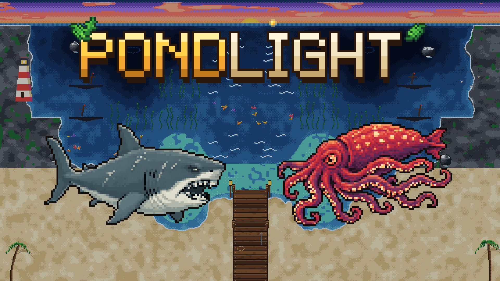
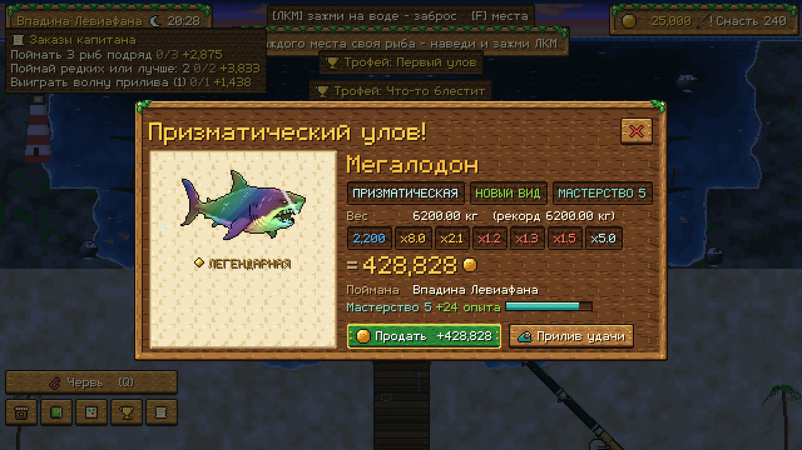
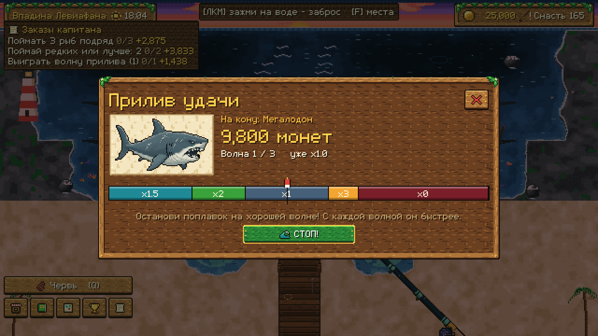
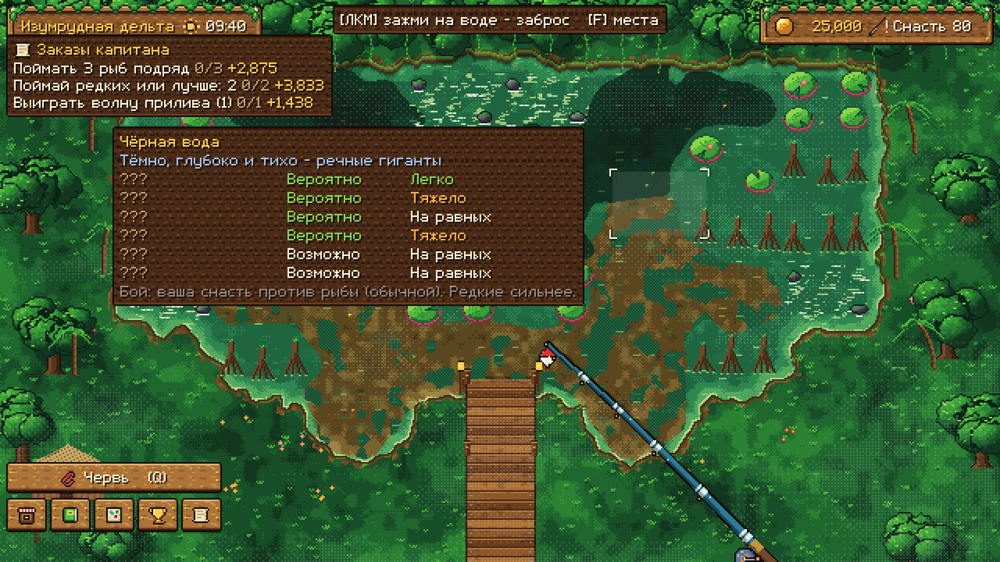
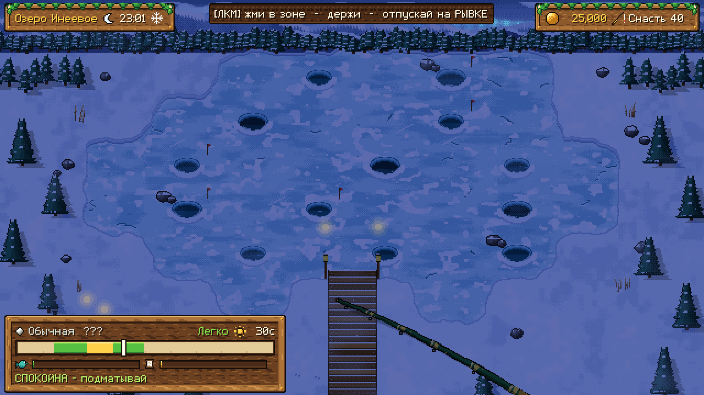
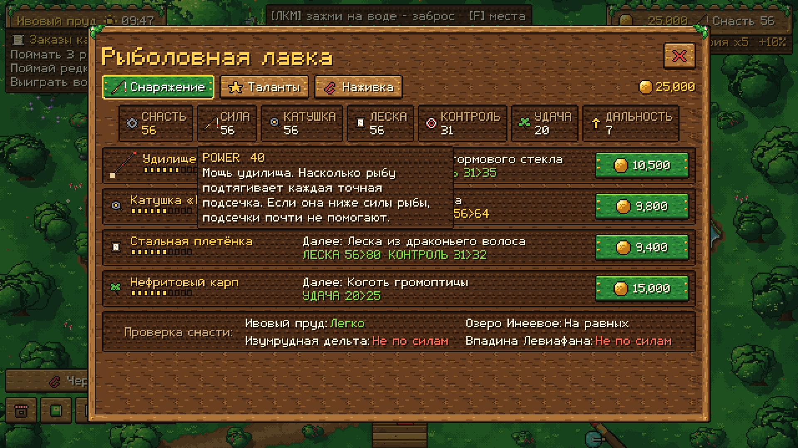
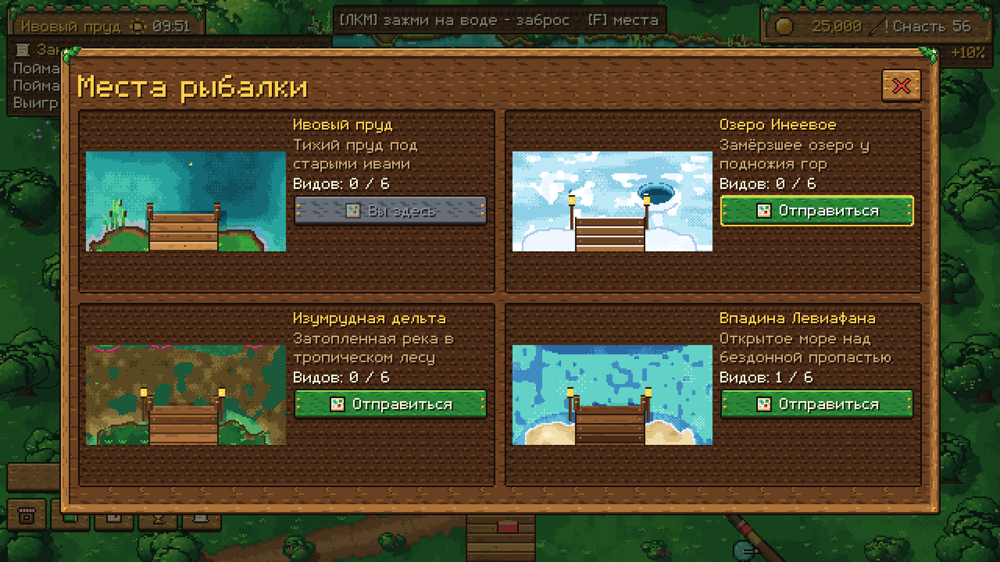

<p align="center">
  
</p>

<h1 align="center">PONDLIGHT</h1>

<p align="center">
  <b>Уютная пиксельная рыбалка, где водоём читается как карта.</b><br>
  <i>A cozy pixel-art fishing game where you read the water.</i>
</p>

<p align="center">
  <a href="https://x1as.github.io/pondlight/"><b>▶ Играть в браузере</b></a> &nbsp;·&nbsp;
  <a href="#скачать">Скачать для Windows</a> &nbsp;·&nbsp;
  <a href="#english">English</a>
</p>

<p align="center">
  
  
  
  
</p>

---

## Об игре

У каждой клетки воды свой характер: мох, тень ивы, кувшинки, корни, глубина. От места зависит, какая рыба клюнет и с каким шансом. Наведи, забрось в зелёную зону, подсеки и выиграй бой: жми в такт, держи, чтобы подматывать, и отпускай на рывке, пока леска не лопнула.

Четыре водоёма ведут от тихого ивового пруда к **Впадине Левиафана**, где в бездне ждут **Кракен** и **Мегалодон**.

<table>
  <tr>
    <td width="50%"><br><sub><b>Подсчёт улова.</b> Цена собирается фишками: база × редкость × размер × мастерство × серия × призма.</sub></td>
    <td width="50%"><br><sub><b>Прилив удачи.</b> Рискни ценой рыбы на волнах от ×0 до ×3.</sub></td>
  </tr>
  <tr>
    <td><br><sub><b>Водоём как карта.</b> Подсказка показывает, кто водится в клетке и по силам ли тебе эта рыба.</sub></td>
    <td><br><sub><b>Бой.</b> Удочка и леска живые: гнутся, натягиваются, краснеют от напряжения.</sub></td>
  </tr>
  <tr>
    <td><br><sub><b>Прокачка.</b> 10 тиров снаряжения, 15 талантов, 8 наживок. У каждой характеристики есть пояснение при наведении.</sub></td>
    <td><br><sub><b>Четыре мира.</b> У каждого своя погода, музыка и шесть видов рыб.</sub></td>
  </tr>
</table>

## Что внутри

| | |
|---|---|
| 🎣 **24 вида рыб** | от синежаберника до Кракена и Мегалодона |
| ⭐ **Редкость на каждый улов** | Обычная → Легендарная; мастерство вида до 20 уровня; **призматические** рыбы (1 из 100) |
| ⚔️ **Снасть против силы рыбы** | сильную рыбу без хорошей снасти не вытянуть; «Легко / На равных / Тяжело / Не по силам» |
| 🔥 **Темп** | горячая серия, кормовое безумие, золотые места, сундуки с сокровищами, заказы капитана |
| 🌙 **Ловушки** | пока игра закрыта, они приносят монеты (до 8 часов) |
| 🏆 **25 трофеев** | и платиновый «Мастер Pondlight» за все |
| 🐸 **Обучение** | старый лягушонок Квак ловит с тобой первую рыбу |
| 📱 **Везде** | Windows, браузер, телефон (горизонтально); русский и английский |

Без доната, рекламы в версии для ПК и подписок.

## Управление

| Действие | Мышь | Телефон | Геймпад |
|---|---|---|---|
| Выбрать место | навести | тап по клетке | стик / крестовина |
| Заброс | зажать ЛКМ и отпустить в зелёной зоне | зажать выбранную клетку | A |
| Подсечка | ЛКМ, когда поплавок нырнул | тап | A |
| Бой | тап в зоне · держать — тянуть · отпустить на рывке | так же | A |
| Смотать | ПКМ | тап во время ожидания | B |
| Места / меню | F / Esc | кнопки внизу | R3 / Start |

## Скачать

- **Играть в браузере:** https://x1as.github.io/pondlight/. На телефоне можно «Добавить на главный экран».
- **Windows:** собрать `build/windows/Pondlight.exe` (см. ниже) или взять у автора архив плейтеста.

## Как собрать

Понадобится [Godot 4.7.2](https://godotengine.org/) с шаблонами экспорта и Python 3.11 с Pillow (для генераторов графики).

```powershell
# тесты + Windows-сборка (+ браузерные сборки)
powershell -ExecutionPolicy Bypass -File build_release.ps1 -Web -Pages
```

- `build/windows/Pondlight.exe` — игра для ПК.
- `build/PONDLIGHT_web.zip` — сборка для Яндекс Игр.
- `docs/` — сборка для GitHub Pages.

Подробности для разработчика — в [DEVELOPMENT.md](DEVELOPMENT.md).

## Как это сделано

- **Godot 4.7, GDScript, рендер Compatibility.** Холст 640×360 с целочисленным масштабом, чистые пиксели.
- **Правила отдельно от сцены.** Редкость, выбор вида, цена, заброс, бой и прилив — чистые классы. Их проверяют **386 автотестов**, включая симуляцию прохождения ботом-игроком.
- **Всё в данных.** Рыбы, водоёмы, снаряжение, таланты, трофеи и баланс лежат в `pondlight/data/*.json`.
- **Графика и звук — генераторы.** Диорамы, интерфейс, пиксельный шрифт с кириллицей и весь звук создают Python-скрипты в `tools/`. Спрайты рыб сгенерированы в SpriteCook и приведены к единому стилю скриптом `tools/art/polish_spritecook.py`.
- **Сохранения надёжные.** Запись атомарная, с резервной копией и миграцией между версиями.

## Документы

| | |
|---|---|
| [DESIGN.md](DESIGN.md) | геймдизайн и история версий |
| [SUCCESS_FORECAST.md](SUCCESS_FORECAST.md) | тренды и прогноз |
| [STEAM_MARKET_RESEARCH.md](STEAM_MARKET_RESEARCH.md) · [BUSINESS_MODEL.md](BUSINESS_MODEL.md) | рынок и деньги |
| [release/README_RELEASE.md](release/README_RELEASE.md) | выпуск на Яндекс Играх и VK Play |
| [IP_AND_RATINGS.md](IP_AND_RATINGS.md) · [ASSET_LICENSES.md](ASSET_LICENSES.md) | права и лицензии |

---

<a id="english"></a>
## English

**PONDLIGHT** is a cozy pixel-art fishing game. Every cell of the water has its own fish and odds. Cast into the green zone, strike when the bobber dives, then win the fight: tap in the zone, hold to reel, let go on a surge.

Explore 4 waters, catch 24 species from Common to Legendary (plus rare Prismatic variants), upgrade 10 tiers of gear, learn 15 talents and collect 25 trophies. Your final targets are **the Kraken** and **the Megalodon**.

▶ **Play in the browser:** https://x1as.github.io/pondlight/ (PC and phone, landscape)

Built with Godot 4.7. Art and audio come from original generator scripts plus polished SpriteCook sprites. 386 automated tests. Russian and English.

---

<p align="center"><sub>Сделано Сабитом (<a href="https://github.com/x1as">@x1as</a>) · 2026</sub></p>
